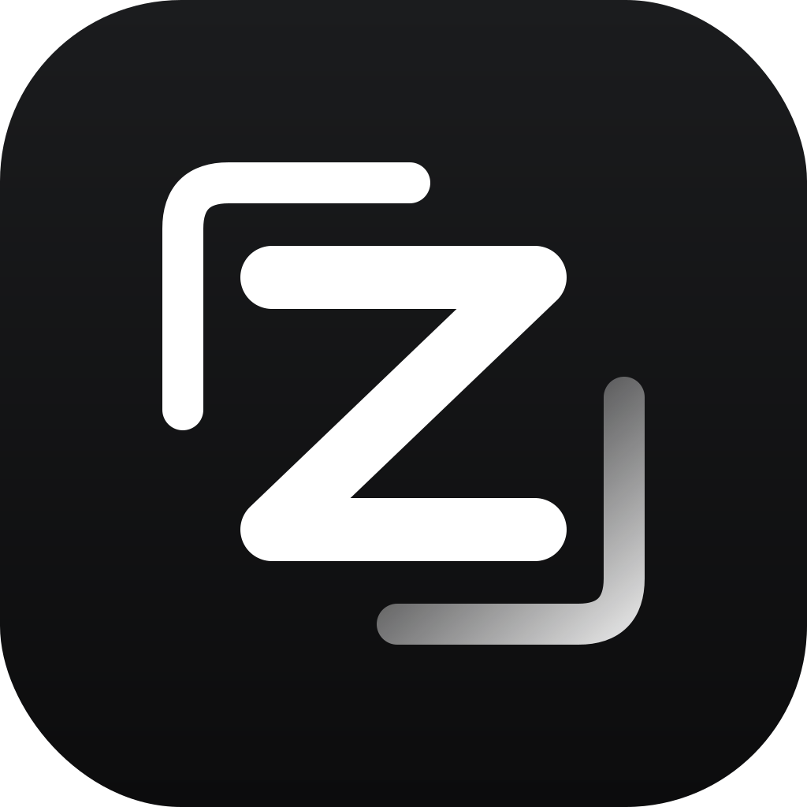

# Zedless

<p align="center">
  
</p>

<p align="center">
  A lightweight, local-first fork of <a href="https://github.com/zed-industries/zed">Zed</a>.<br>
  No account, no agent panel, no extension store, no telemetry.
</p>

<p align="center">
  <a href="LICENSE"></a>
  <a href="https://github.com/0xMinomus/zedless/releases"></a>
  
</p>

Zedless keeps Zed's editor core and native UI, then removes the surfaces that
make an editor heavy: the agent panel, AI providers, collaboration UI, extension
store, crash reporter, telemetry upload and the upstream updater. What is left is
a fast local editor with LSP, tree-sitter, terminals, git, debugger, project
search and multi-cursor editing.

Zedless is an **unofficial fork**. It is not affiliated with, endorsed by, or
supported by Zed Industries. See [NOTICE](NOTICE) and [Trademark](#trademark).

## Status

- **0.1.0** — first public build.
- Linux x86_64: tested, released as a tarball.
- Windows x86_64: portable zip produced by the release workflow; unsigned, so
  SmartScreen will warn on first launch.
- macOS: not built; the fork is not tested there.

## Features

| Kept | Removed |
|---|---|
| Editor core: rope buffer, multi-cursor, vim mode | Agent panel, ACP tools, sidebar threads |
| Tree-sitter syntax + LSP (Rust, TS/JS, Python, Go, C/C++, JSON, CSS, YAML, …) | AI providers, copilot, inline assist, edit prediction |
| Project panel, search, outline, git panel, debugger, terminal | Collaboration panel, calls, channel UI |
| Settings UI, keymaps, themes (built-in) | Extension store and extension auto-install |
| Local-first: no login, no cloud calls on startup | Crash reporter, telemetry upload, upstream updater |

## Memory and CPU benchmark

One machine (Fedora 44, Intel RAPTORLAKE-S, Mesa 26.2.4), fresh profile, cold
page cache, one run per app:

| Metric | Zed 1.26.2 | Zedless 0.1 | Orca 1.4.219 |
|---|---:|---:|---:|
| **RAM, idle** | 294 MB | **149 MB** | 756 MB |
| **CPU, idle** (30 s median) | 0.0 % | **0.0 %** | 0.0 % |
| CPU, idle (30 s mean) | 0.7 % | 0.9 % | 2.6 % |
| **RAM, project open** | 297 MB | **150 MB** | —¹ |
| **CPU, project open** (20 s avg) | 16.0 % | **1.4 %** | —¹ |
| **Peak CPU during launch** | 235 % | **12 %** | 346 % |
| Processes | 2 | **1** | 7 |
| Binary / install | 220 MB | **188 MB** | 204 MB AppImage |
| `.text` | 155.5 MB | **132.5 MB** | n/a (Electron) |

How to read this:

- **RAM** is resident set size (RSS) summed across every process the app owns,
  not just its main process. Idle is measured 10 s after launch; project is
  `~/Documents/Alpro` opened for 20 s. Values are cold-page-cache, so warm runs
  may read 10–18 MB higher.
- **CPU** is the share of *one logical core*; it can exceed 100 % when an app
  uses several threads. Idle is reported both as median and mean over 30 s:
  a median of 0.0 % for all three apps means they sleep most of the time and
  wake only for short timers, so the mean is dominated by those bursts. Under
  load the difference is real: Zedless uses ~1.4 % versus Zed's 16 %.
- **Peak CPU** is the highest 0.5 s sample during launch. Zed and Orca spike
  while compiling shaders and starting service processes; Zedless starts one
  process and stays near idle.
- Zed's crash-helper process is included in its RAM total. Language servers run
  as separate processes and are not counted for any app.
- Orca has no CLI argument for opening a folder, so its project row is not
  measured; its launch plateau is 955 MB / 346 % CPU. Orca was run from an
  extracted AppImage with its whole Electron process tree summed: main 352 MB,
  renderer 207 MB, GPU 181 MB, network service 88 MB, three zygotes ~132 MB.

Zedless has the **lowest CPU under project work (1.4 % vs 16 %) and the lowest
launch spike (12 % vs 235 % / 346 %)**, and is **~2× lighter than Zed** in RAM.
It is also **~5× lighter than Orca** at idle (~6.5× at Orca's launch plateau).
Reproduce RAM with `script/zedless-mem`; CPU numbers require a process-tree
sampler.

### Known limitations

- `client`, `call`, `channel` and `extension_host` are still linked because the
  editor core depends on them. Removing them needs editor/project API rework,
  not UI trimming.
- ~100 MB idle is not reachable with GPUI as-is; the practical floor here is
  ~145–150 MB.
- Windows builds are unsigned and untested by the maintainer at release time.

## Install

### Linux (x86_64)

Download `zedless-linux-x86_64.tar.gz` from the
[latest release](https://github.com/0xMinomus/zedless/releases/latest), then:

```sh
tar -xzf zedless-linux-x86_64.tar.gz
cd zedless-linux-x86_64
./install.sh
```

This installs the binary to `~/.local/lib/zedless`, the `zedless` launcher to
`~/.local/bin`, a desktop entry and the icon. Start it from the application menu
or with `zedless /path/to/project`.

Uninstall:

```sh
rm -rf ~/.local/lib/zedless ~/.local/bin/zedless \
  ~/.local/share/applications/dev.zedless.Zedless.desktop \
  ~/.local/share/icons/hicolor/512x512/apps/zedless.png
```

### Windows (x86_64)

Download `zedless-windows-x86_64.zip`, extract it anywhere and run
`zedless.exe`. The build is portable: settings live in `%APPDATA%\Zedless`.
Windows SmartScreen will warn because the binary is unsigned; use *More info →
Run anyway* only if you trust the release checksum.

### Build from source

Requirements: Rust 1.98+, clang, lld, llvm-objcopy, protoc and the Linux
dependencies installed by `script/linux` (Fedora/Debian/Arch/openSUSE).

```sh
script/zedless-build          # release binary at target/release/zedless
script/zedless-install       # user install into ~/.local
```

Fast iteration: `cargo build --profile release-fast -p zed`.

## Repository layout

| Path | Purpose |
|---|---|
| `crates/zed` | application entry, window/workspace wiring |
| `crates/editor`, `crates/project` | editor and LSP/project core |
| `crates/gpui*` | UI framework |
| `script/zedless-build` | reproducible release build (opt-level=z, thin LTO, ICF, strip) |
| `script/zedless-install` | per-user install |
| `script/zedless-mem` | idle memory benchmark |
| `packaging/` | archive installer used by releases |

## Contributing

Contributions are welcome. Read [CONTRIBUTING.md](CONTRIBUTING.md) first.
Please also read the [Code of Conduct](CODE_OF_CONDUCT.md). Security issues go
through [SECURITY.md](SECURITY.md), not public issues.

## License

Zedless is distributed under **GPL-3.0-or-later**, inherited from Zed. You may
use, modify and redistribute it under the same license; if you distribute a
binary you must also make the corresponding source available. See [LICENSE](LICENSE),
[LICENSE-GPL](LICENSE-GPL) and [LICENSE-APACHE](LICENSE-APACHE).

Upstream: [zed-industries/zed](https://github.com/zed-industries/zed), based on
tag `v1.26.2` (commit `c4273271092b0287f7d181f616bd5171e0a2f70c`).

## Trademark

“Zed” and the Zed logo are trademarks of Zed Industries. Zedless uses its own
name and logo, does not ship Zed branding, and is not affiliated with Zed
Industries. The Zedless name and logo identify this fork only.
